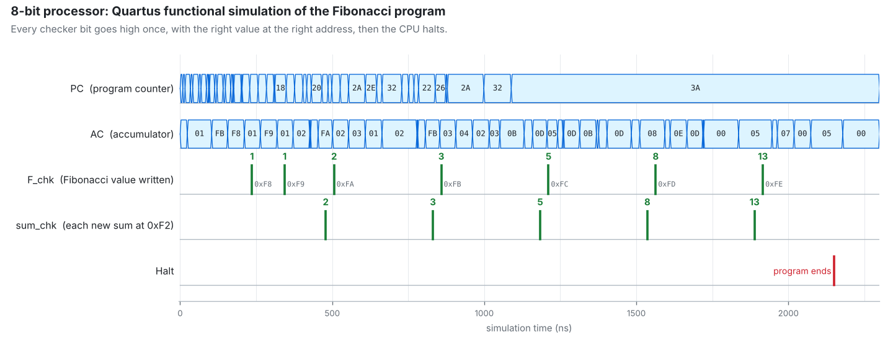

# 8-Bit Processor on FPGA

A simple 8-bit accumulator-based CPU built in **Intel Quartus Prime** for the **Altera DE2-115 (Cyclone IV E)** board, as a team lab project for CEG 2136 (Computer Architecture I) at the University of Ottawa.

## What's inside

| Block | File | Role |
|---|---|---|
| 8-bit ALU | `alu8bits.bdf`, `alu1bit.bdf`, `fulladder1bit.bdf`, `partialadder1bit.bdf` | Arithmetic and logic operations, built from 1-bit slices |
| Registers | `register8bits.bdf`, `register1bit.bdf` | Accumulator (AC), Data (DR), Address (AR), Instruction (IR) registers |
| Program counter | `counter8bits.bdf`, `counter4bits.bdf`, `counter1bit.bdf` | Steps through program memory |
| Control unit | `lab4controller.bdf`, `sc_ctrl.bdf`, `controlregister.bdf` | Decodes each instruction and drives the load, increment, bus and ALU select signals |
| Bus | `busmultiplexer.vhd` | 8-to-1 multiplexer that picks which value goes on the shared bus |
| Memory | `ram256x8.vhd`, `memorycontents8.mif` | 256 x 8 RAM holding the program and data |
| Display | `sevensegcontroller.bdf`, `seg7.vhd` | Shows register values on the 7-segment displays |
| Checker | `checker.sv` | Watches memory writes and flags each correct result |
| Top level | `lab4top.bdf` | Connects everything: datapath, controller, RAM, DIP switches, displays |

## Test program

`memorycontents8.mif` contains a machine-code program that computes the **Fibonacci sequence (1, 1, 2, 3, 5, 8, 13)** and writes each value to memory at `0xF8` to `0xFE`.
`checker.sv` watches the memory writes and flags each correct value, and `Test1.vwf` is the waveform simulation used to verify it.

## Results

- **Simulation:** in the Quartus functional simulation (`simulation/qsim/Lab4.sim.vwf`), all 7 Fibonacci checks and all 5 sum checks go high, then the CPU halts (graph above).
- **Compilation:** the design compiles and fits on the Cyclone IV E: 272 logic elements, 80 registers and 2,048 memory bits (the 256 x 8 RAM). Reports are in `output_files/`.

## Open it

1. Open `Lab4.qpf` in Quartus Prime 13.0 SP1 (the top-level entity is `lab4top`).
2. To run it on a DE2-115 board, program `output_files/Lab4.sof` with the Quartus Programmer. The pin assignments are in `Lab4.qsf`.

## Tools
Intel Quartus Prime 13.0 SP1 · Cyclone IV E (EP4CE115F29C7) · VHDL · SystemVerilog · block diagrams (BDF)
